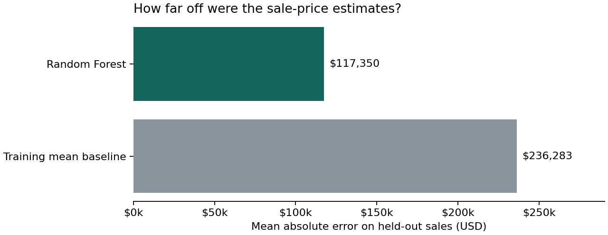

# How accurately can we predict a house’s sale price?

A random forest missed sale prices by **$117,350 on average** across 902 held-out sales. Predicting the training-set mean for every home missed by **$236,283**. That amounts to a **50.3% reduction in average absolute error**. A few very large misses remained, and the forest explained only about 10% of test-set price variation.



| Model | Mean absolute error | Test R² |
| --- | ---: | ---: |
| Training-set mean | $236,283 | −0.0038 |
| Random forest | $117,350 | 0.1009 |

## Method

The source contains 4,600 historical Washington home sales. Removing 49 zero-price entries left 4,551 sales. The split assigns whole addresses to either training (3,649 rows) or testing (902 rows), so repeated addresses cannot appear on both sides. The split uses seed 42.

The model uses 14 features, including living area, condition, city and ZIP code. Price per square foot would reveal information about the sale price, so it is excluded. Numeric imputation and categorical encoding are fitted on training rows only. The forest averages 200 trees with at least two training samples per leaf.

## Interpretation

MAE answers “How many dollars off was the estimate on average?” R² gives a different view because it is sensitive to large squared errors. In the saved class run, one $250,000 home received an estimate above $6.6 million. Investigating unusual transactions would be a good next step. This address-grouped split tests unseen properties in this historical dataset. It does not test future prices or other markets.

## Reproduce

1. Download the [Kaggle House Price Prediction dataset](https://www.kaggle.com/datasets/debayank2024/house-price-prediction) and extract modified_data.csv beside analyze.py.
2. Using Python 3.12, run the commands below from this folder.

```sh
python -m venv .venv
source .venv/bin/activate
python -m pip install -r requirements.txt
python analyze.py
```

On Windows PowerShell, activate with `.venv\Scripts\Activate.ps1`. The script writes the [metrics](results/metrics.csv) and chart to results/. The input CSV used for the verified run had SHA-256 digest `6b0c407d819a0d41b28eaaf2a5f64d874832d2e2312dd5f9c737a139fd331aaa`.

## Project history

Adapted from Gonzalo Martinez-Valeriano’s CINF 428 random-forest analysis. Portfolio preparation added a reproducible dependency list, exported metrics and a comparison chart. Results were rerun against the source CSV and checked against the saved course output.
